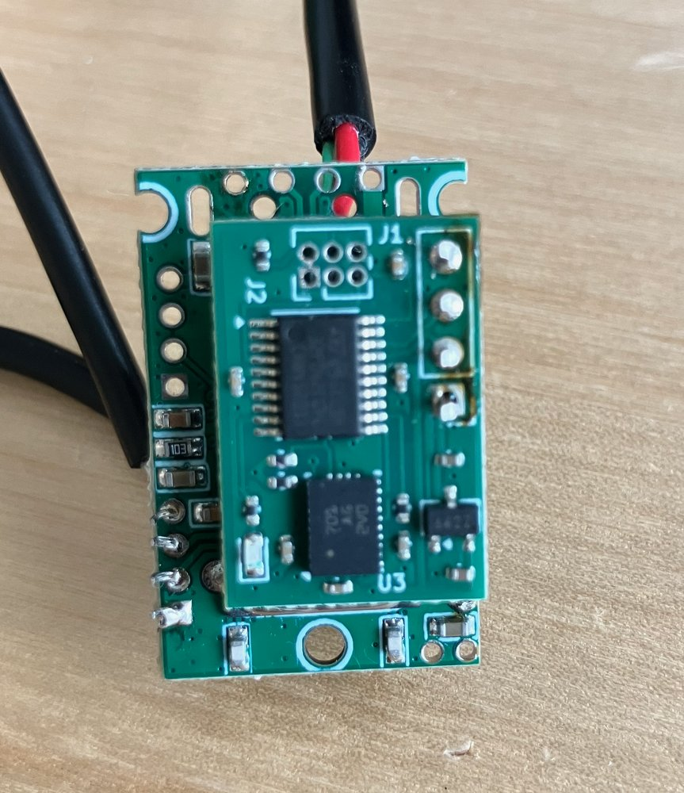

# USB IMU for camera rigs

Small KiCad 9 boards that add a Bosch BNO055 9-axis IMU to a pair of USB cameras mounted on a 3/4" webbing strap.

| Folder | Board | Status |
|---|---|---|
| [`hub_imu/`](hub_imu/) | **hub_imu** ("EweFeel 1.0"): 21 x 14.4 mm module. An STM32F042 bridges USB to the BNO055 over I2C. It stacks onto a hub through a 1x4 2.54 mm header. | Built and working |
| [`hub_cam/`](hub_cam/) | **hub_cam**: FE1.1S 4-port USB 2.0 high-speed hub carrier, about 16.5 x 23 mm. It has two JST-GH crimp connectors for the cameras, solder holes for the host cable, and a header that the hub_imu module stacks onto. | Schematic drafted, layout not started |

## Why hub_cam

hub_imu was first stacked onto an off-the-shelf FE1.1S hub board ([Amazon](https://www.amazon.com/dp/B0GTVPVPV9)). That hub has two problems:

- Its port holes are on a 2.0 mm pitch, so they don't line up with hub_imu's 2.54 mm header.
- The camera wires have to be soldered to it, and their insulation melts easily.

hub_cam replaces that hub with one sized to the strap. The cameras plug in through crimped JST-GH connectors, and the existing hub_imu modules stack directly on top.

## License

All hardware in this repository is licensed under the [CERN Open Hardware Licence v2, Permissive](LICENSE) (CERN-OHL-P-2.0).
