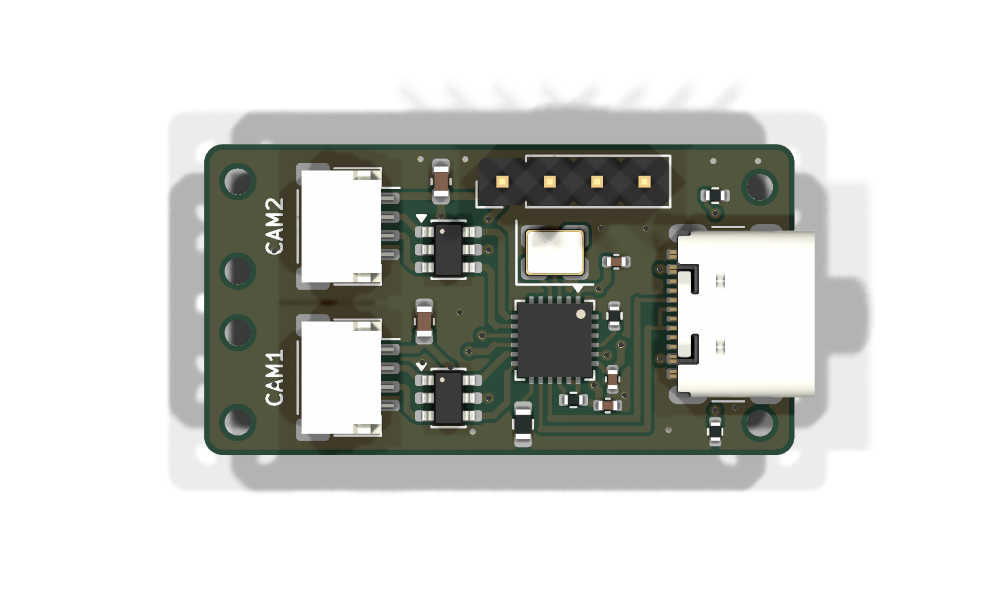
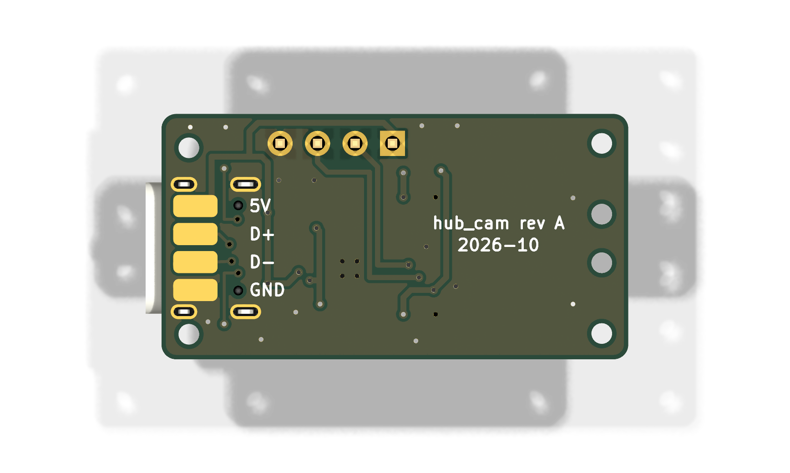

# hub_cam: USB hub carrier for two cameras plus the hub_imu module

**Status:** schematic and PCB layout done, DRC clean (0 errors, 0 unconnected). Fab outputs not generated yet.

## Board

- 31.66 x 16.65 mm, 1.0 mm thick, 2 layers, JLCPCB standard rules (0.2 mm track/space, 0.6/0.3 mm vias).
- All SMD parts are on the top, so JLCPCB assembles one side only.
- The hub_imu module stacks on the back on J1.
- Host end: USB-C receptacle J4, with its mouth at the board edge.
- Camera end: a 4.8 mm shelf in front of the two camera connectors.
- Thread holes: 6 non-plated, 1.4 mm. Four are on the camera shelf, for lashing the camera cables (strain relief). Two are at the USB end, one on each side of the connector. All are for sewing the board to the harness straps.
- Dimensions are drawn on the User.Drawings layer (`dimensions_stage5.png`).

## Parts

| Ref | Part | LCSC / JLCPCB # | Role |
|---|---|---|---|
| U1 | FE1.1S-BQFN24B (QFN-24, 4x4 mm) | C6776948 (extended) | USB 2.0 high-speed 4-port hub |
| Y1 | 12 MHz crystal, 3225 package | C9002 | Hub clock. The FE1.1S has internal load capacitors, so none are fitted. |
| R1 | 2.7k 1%, 0603 | C13167 | REXT bias resistor |
| R2, R3 | 10k, 0402 | C25744 | XRSTJ pull-up, DRV pull-down (normal hub mode, charging off) |
| R4, R5 | 5.1k, 0402 | C25905 | CC1/CC2 pull-downs. They identify the board as a USB device, so C-to-C cables supply VBUS. |
| C1, C2 | 10 uF 0603, 100 nF 0402 | C96446, C1525 | 5 V input to the hub |
| C3, C4 | 4.7 uF, 100 nF 0402 | C23733, C1525 | Output of the hub's internal 3.3 V regulator (VD33F) |
| C5 | 10 uF 0603 | C96446 | 5 V bulk capacitor at the camera connectors |
| U2, U3 | USBLC6-2SC6 (SOT-23-6) | C7519 (extended) | ESD protection at each camera connector. D-/D+ pass through pins 1-6 and 3-4. |
| J4 | USB-C receptacle, 16P, USB 2.0 (GCT USB4105 footprint) | C2765186 (extended) | Host connection. Shield to GND; SBU not connected. |
| J2, J3 | JST SH 4-pin, side entry (SM04B-SRSS-TB) | C160404 (extended) | Camera ports CAM1 / CAM2. Pinout: 1 VBUS, 2 D-, 3 D+, 4 GND |
| J1 | 1x4 2.54 mm pin header | hand-fitted | Stacking header for hub_imu. Same footprint and pin order as hub_imu's J1. |
| J5-J8 | Bare SMD pads on the back, 1.5 x 3 mm | - (copper only) | Backup host wiring if J4 is left off. Labelled on the silkscreen: 5V, D+, D-, GND. |

JLCPCB has no Basic-library USB-C or JST parts, so J2-J4 are Extended parts (an extended-part fee each).

### Camera cables (JST SH, crimped)

| Item | LCSC # | Note |
|---|---|---|
| Housing SHR-04V-S | C385125 | Not the NSHR variant |
| Contact SSH-003T-P0.2-H | C263995 | 28-32 AWG, insulation up to 0.8 mm OD |
| Crimper | - | For example Engineer PA-09 (1.0 mm die) |

## Port map

| Hub port | Connected to |
|---|---|
| 1 | CAM1 (J2) |
| 2 | IMU (J1) — middle pins, so its pair can drop to the top layer between the camera pairs |
| 3 | CAM2 (J3) |
| 4 | Unused |

## Hub configuration

- **Self-powered (BUSJ tied high).** The host then doesn't limit the cameras to 100 mA each. Nothing on the board limits or switches the camera power.
- **VBUSM and OVCJ tied to 3.3 V.** There is no over-current sensing.
- **ESD protection on the camera ports only.** The host USB-C port has none. That decision dates from the earlier design, when the host cable was soldered on permanently.

## Silkscreen

- Reference designators are hidden on the silkscreen because the board is too dense for them. They remain on the Fab layers.
- The top is labelled CAM1 / CAM2.
- The back is labelled with the wire-pad names and "hub_cam rev A 2026-10".
